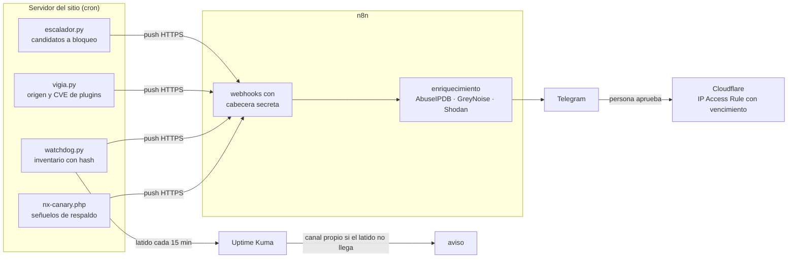

# Kit de detección para WordPress tras Cloudflare

> **In English.** This is the detection layer NexaSec runs on its own WordPress site after a migration left full-site
> backups publicly downloadable. Four small cron scripts on the web server (a backup-decoy canary, a hashed web-root
> watchdog, an origin/plugin-CVE checker and a block escalator) **push** events to n8n, which enriches them and alerts
> on Telegram; Uptime Kuma acts as a dead-man's switch. Design principles: push not pull, a silent failure is an alert,
> a human approves every block, and every block expires. Python standard library only, Apache-2.0.
> Contact: [nexasec.cl](https://nexasec.cl) · seguridad@nexasec.cl

## El caso

En agosto de 2026, una migración hecha por el proveedor externo que construyó [nexasec.cl](https://nexasec.cl) dejó
respaldos completos del sitio descargables desde internet durante varias semanas. Cuando lo detectamos, en septiembre,
sacamos los archivos, asumimos que alguien pudo haberlos descargado y rotamos todas las credenciales.

Lo que más nos enseñó no fue el error, que en una migración le puede pasar a cualquiera, sino que **nada avisó**.
No había un control que viera aparecer un respaldo en el web root, ni uno que notara a alguien buscándolo, ni uno que
dijera si el servidor seguía escondido detrás de Cloudflare. Este kit es lo que construimos para que la próxima vez se
sepa en minutos y no en semanas. Es la versión genérica de lo que corre hoy en nuestro propio sitio.

## Cómo funciona



## Principios

- **Push y no pull.** El servidor le habla a n8n; n8n nunca entra al servidor. No hay llaves SSH en la plataforma de
  automatización, y un compromiso de n8n no da acceso al sitio.
- **Un fallo silencioso es una alerta.** El watchdog late contra Uptime Kuma en cada corrida y el latido lleva el
  resultado de la entrega a n8n. Si el cron muere, el servidor cae o n8n no responde, avisa un canal que no depende
  de n8n. Los scripts además detectan cuando un 200 no es lo que parece (la página de login de Access, por ejemplo).
- **Una persona en el bucle.** Nada se bloquea solo: el escalador propone y una persona aprueba en Telegram.
- **Todo bloqueo vence.** Las reglas se crean con fecha de vencimiento y un workflow diario las retira.

## Las piezas

| Pieza | Qué detecta | La decisión que importa |
|---|---|---|
| [`nx-canary.php`](servidor/nx-canary.php) | Alguien buscando respaldos (`backup.zip`, `*.wpress`, `ai1wm-backups/`, `.env`…) | Responde un 404 **no cacheable**: el escáner sigue de largo y cada intento llega al origen. Un *señuelo crítico* con la URL exacta de un archivo que estuvo expuesto separa lo dirigido del ruido. |
| [`watchdog.py`](servidor/watchdog.py) | Respaldos nuevos en el web root, PHP en `uploads`, cambios en `mu-plugins`, drop-ins, `wp-config.php` y `.htaccess` | Las zonas de persistencia se comparan **por hash**: tamaño y fecha se falsifican con `touch -r`. |
| [`vigia.py`](servidor/vigia.py) `--origen` | Que el servidor siga cerrado: directo a la IP debe dar 403 y por Cloudflare 200 | Sin valores por defecto: probar contra una IP equivocada daría un "todo bien" falso. |
| [`vigia.py`](servidor/vigia.py) `--plugins` | Core, plugins y temas con vulnerabilidades conocidas, según el feed de Wordfence Intelligence; opcionalmente el vencimiento de un dominio `.cl` | Cuando las versiones ya no se ven desde fuera ([`nx-versiones.php`](servidor/nx-versiones.php)), el único lugar donde compararlas es el propio servidor. |
| [`escalador.py`](servidor/escalador.py) | IPs que Wordfence bloqueó o que tocaron señuelos de forma significativa | Ordena lo dirigido antes que el ruido, no repropone la misma IP en 7 días y nunca propone rangos de Cloudflare ni privados. |
| [`n8n/`](n8n/) | — | Seis workflows: alertas del canary, del watchdog y del vigía, escalado con aprobación, expiración de bloqueos y errores de workflows. |

Todo lo propio de una instalación está en un `config.json` fuera del web root ([ejemplo](config.ejemplo.json)). Las
reglas de `.htaccess` están en [`servidor/htaccess.ejemplo`](servidor/htaccess.ejemplo) y los horarios en
[`servidor/crontab.ejemplo`](servidor/crontab.ejemplo).

## Cierre del origen

Cloudflare solo protege si nadie puede hablarle directo al servidor, y la IP del origen se filtra con facilidad
(registros DNS antiguos, certificados, cabeceras de correo). La idea:

1. Una **Transform Rule** de Cloudflare agrega a cada petición una cabecera con un valor secreto.
2. El `.htaccess` del origen responde 403 a toda petición que no la traiga:

```apache
# BEGIN NexaSec Origen
RewriteEngine On
RewriteCond %{HTTP:<NOMBRE_CABECERA>} !^<VALOR_SECRETO>$
RewriteRule ^ - [F]
ErrorDocument 403 "Forbidden"
# END NexaSec Origen
```

`vigia.py --origen` comprueba cada hora que esto siga así y avisa si alguien restaura un `.htaccess` viejo, borra la
regla o pausa Cloudflare. La rotación del secreto y la verificación completa son parte de nuestro servicio.

## Lecciones de terreno

- **`REMOTE_ADDR` o `CF-Connecting-IP`.** En algunos hosting, `REMOTE_ADDR` ya trae la IP real cuando la petición viene
  de Cloudflare, y la cabecera puede inventarla cualquiera que le hable directo al origen. Fiarse de ella deja que el
  atacante elija qué IP aparece en las alertas. El canary tiene dos modos (`ip_cliente`) y registra la cabecera como
  falsificada cuando no la acepta.
- **Error 1010.** Sin un User-Agent explícito (`urllib` manda `Python-urllib/3.x` y el curl de PHP no manda ninguno), el
  Browser Integrity Check de Cloudflare rechaza la petición. La alerta se pierde sin ruido.
- **El 404 cacheado ciega al señuelo.** Cloudflare cachea los 404 de rutas como `*.zip` durante unos minutos: el segundo
  intento lo responde el borde y el origen nunca se entera. Por eso el canary envía `Cloudflare-CDN-Cache-Control: no-store`.
- **Un 200 que no es un 200.** Si n8n o Uptime Kuma están detrás de Cloudflare Access, una petición sin el service token
  recibe la página de login con código 200. Los scripts comprueban que la respuesta sea la esperada (JSON) y no solo el código.
- **4.10 es mayor que 4.9.** Un orden lexicográfico de versiones pierde vulnerabilidades. `vigia.py` porta
  `version_compare()` de PHP, que es como comparan WordPress y Wordfence.
- **NIC Chile no tiene RDAP.** El vencimiento de un `.cl` solo se consulta por whois en el puerto 43, que n8n no puede
  abrir. Por eso esa consulta corre en el servidor.

## Qué no cubre

- No reemplaza un WAF ni un antivirus del servidor: **detecta**, no previene.
- No evita una exposición: avisa cuando aparece el archivo o cuando alguien lo busca.
- En Cloudflare Free, una descarga exitosa (GET con 200) no deja evento de firewall. Si el archivo ya estaba expuesto
  antes de instalar esto, solo los logs del hosting pueden decir si alguien lo descargó.

## Pruebas

```bash
python3 -m venv .venv && .venv/bin/pip install pytest
.venv/bin/pytest
```

Las pruebas del canary necesitan `php` en el PATH; sin PHP se saltan. El CI corre todo en Python 3.9 y 3.12, con PHP 8.2.

## Lo que hacemos además

Este repositorio es la capa de detección. En [NexaSec](https://nexasec.cl) también hacemos:

- **Auditoría del Audit Log de Cloudflare**: cada cambio en la cuenta, explicado y clasificado según quién lo hizo y si
  puede tumbar el sitio.
- **Archivo y resumen de los eventos del firewall** de Cloudflare, más allá de la retención del plan.
- **Recordatorios de mantenimiento**: tokens por vencer, cambios de DMARC pendientes, vencimiento del `security.txt`.
- **Despliegue completo** en tu sitio: cierre del origen, Access, reglas WAF, este kit y el runbook para operarlo.

¿Quieres esto en tu sitio? Escríbenos a **seguridad@nexasec.cl** o entra a [nexasec.cl](https://nexasec.cl).

## Licencia

[Apache-2.0](LICENSE). Copyright 2026 NexaSec SpA.
